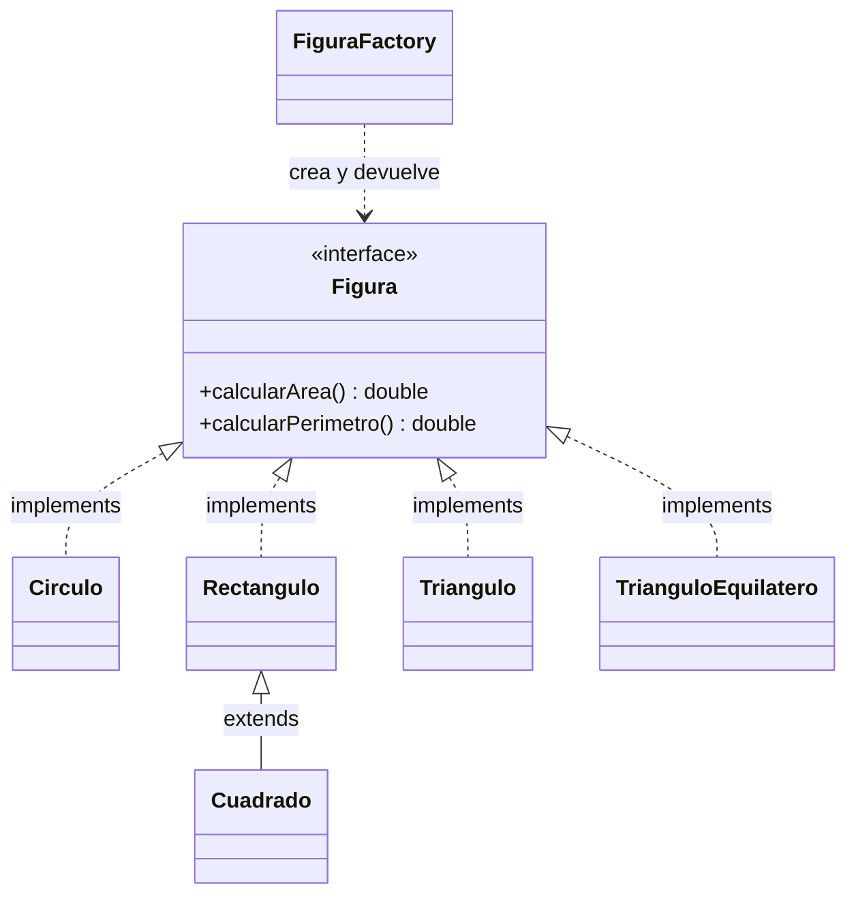

# Reflexión y Máquinas de Interpretación

## Objetivo

Esta aplicación académica demuestra cómo crear figuras geométricas en tiempo de ejecución mediante la API de reflexión de Java. También permite compilar y registrar nuevas figuras escritas en Groovy mientras Spring Boot está ejecutándose, sin agregar un archivo Java ni reiniciar la aplicación.

## Tecnologías

- Java 17
- Spring Boot 4.1.1
- Maven y Maven Wrapper
- Java Reflection API
- Apache Groovy 4.0.28

## Arquitectura

Para crear una figura nativa o previamente registrada, el flujo es:

```text
Cliente
  ↓
FiguraController
  ↓
FiguraFactory
  ↓
Reflection
  ↓
Figura
```

Para cargar una figura nueva durante la ejecución:

```text
Código Groovy
  ↓
GroovyClassLoader
  ↓
Compilación en tiempo de ejecución
  ↓
Verificación e inclusión en el registro dinámico
  ↓
FiguraFactory
  ↓
Figura
```

Los modelos están en `model`, los servicios de creación y compilación en `service`, los endpoints en `controller` y los objetos de entrada/salida en `dto`.

## Figuras nativas

La aplicación incluye `Circulo`, `Cuadrado`, `Rectangulo`, `Triangulo` y `TrianguloEquilatero`. Todas implementan:

```java
public interface Figura {
    double calcularArea();
    double calcularPerimetro();
}
```

## Diseño Orientado a Objetos

La solución aplica los principios básicos de diseño orientado a objetos sin agregar capas innecesarias:

- **Abstracción:** `Figura` define las operaciones comunes `calcularArea()` y `calcularPerimetro()`, sin imponer cómo se calculan para cada forma.
- **Polimorfismo:** `FiguraFactory` y el controlador trabajan con referencias del tipo `Figura`. La misma llamada a `calcularArea()` funciona para un círculo, un rectángulo, un triángulo o cualquier figura dinámica registrada.
- **Herencia:** `Cuadrado` extiende `Rectangulo`, llama a `super(lado, lado)` y reutiliza los cálculos de área y perímetro del rectángulo.
- **Encapsulamiento:** cada clase mantiene sus dimensiones como atributos privados y expone únicamente las operaciones del contrato `Figura`.

El triángulo general se modela en `Triangulo` con los lados `ladoA`, `ladoB` y `ladoC`. Su perímetro es la suma de los lados y su área se calcula con la fórmula de Herón. `TrianguloEquilatero` se conserva como una figura nativa de la actividad anterior.

### Diagrama de clases



### Historias de usuario

- **HU-01 Crear una figura:** como usuario, quiero seleccionar un tipo de figura e ingresar sus dimensiones para que el sistema cree la figura correspondiente.
- **HU-02 Calcular el área:** como usuario, quiero calcular el área de una figura para conocer la superficie que ocupa.
- **HU-03 Calcular el perímetro:** como usuario, quiero calcular el perímetro de una figura para conocer la longitud total de su contorno.
- **HU-04 Utilizar diferentes figuras:** como usuario, quiero trabajar con distintos tipos de figuras mediante las mismas operaciones para no depender de una implementación específica.

## Ejecución

En Windows, desde la carpeta del proyecto:

```powershell
.\mvnw.cmd spring-boot:run
```

La API queda disponible en `http://localhost:8080`.

## Ejemplos de uso

Crear un círculo:

```http
POST http://localhost:8080/api/figuras/crear
Content-Type: application/json

{
  "clase": "Circulo",
  "parametros": {
    "radio": 5
  }
}
```

Respuesta aproximada:

```json
{
  "figura": "Circulo",
  "area": 78.53981633974483,
  "perimetro": 31.41592653589793
}
```

Crear un rectángulo:

```http
POST http://localhost:8080/api/figuras/crear
Content-Type: application/json

{
  "clase": "Rectangulo",
  "parametros": {
    "base": 10,
    "altura": 5
  }
}
```

Cargar un pentágono con Groovy:

```http
POST http://localhost:8080/api/figuras/cargar-groovy
Content-Type: application/json

{
  "codigo": "import com.arquitectura.figuras.model.Figura\n\nclass Pentagono implements Figura {\n    double lado\n\n    double calcularArea() {\n        return (Math.sqrt(5 * (5 + 2 * Math.sqrt(5))) / 4) * lado * lado\n    }\n\n    double calcularPerimetro() {\n        return 5 * lado\n    }\n}"
}
```

Respuesta:

```json
{
  "mensaje": "Clase cargada correctamente",
  "clase": "Pentagono"
}
```

Sin reiniciar Spring, crear el pentágono inmediatamente:

```http
POST http://localhost:8080/api/figuras/crear
Content-Type: application/json

{
  "clase": "Pentagono",
  "parametros": {
    "lado": 5
  }
}
```

También se puede comprobar que la API está activa con `GET /api/figuras`.

## Creación mediante constructores y Reflection

Las figuras nativas declaran constructores parametrizados con `@ConstructorProperties`, que relaciona cada argumento con el nombre recibido en el `Map`. Por ejemplo, `Circulo` declara `@ConstructorProperties({"radio"})` en `Circulo(double radio)` y `Rectangulo` declara los nombres `base` y `altura`.

Para crear un círculo, `FiguraFactory` sigue este flujo genérico:

```text
"Circulo"
    ↓
Class.forName(...)
    ↓
Class<Circulo>
    ↓
getDeclaredConstructor(double.class)
    ↓
Constructor<Circulo>
    ↓
newInstance(5.0)
    ↓
Circulo
    ↓
Figura
    ↓
calcularArea()
```

La fábrica inspecciona los constructores, obtiene sus nombres mediante `ConstructorProperties`, compara esos nombres con las claves del request y convierte cada valor al tipo esperado. El orden del JSON no afecta la selección. Conceptualmente, el resultado equivale a `new Circulo(5.0)`, pero la fábrica nunca escribe el nombre concreto de la figura ni invoca directamente su constructor.

## Asignación mediante Field

Las figuras cargadas desde Groovy pueden tener solamente un constructor vacío implícito, como el `Pentagono` del ejemplo. Si no existe un constructor parametrizado anotado compatible, `FiguraFactory` usa `getDeclaredConstructor().newInstance()` y asigna cada parámetro con `Field`, `setAccessible(true)` y `field.set(...)`.

Así se conservan los dos usos de Java Reflection: `Constructor` permite localizar y ejecutar una clase con argumentos en tiempo de ejecución, mientras que `Field` permite modificar sus atributos cuando una clase dinámica no ofrece un constructor parametrizado compatible.

## Cómo funciona Groovy en tiempo de ejecución

`GroovyClassLoader` recibe el texto enviado por el cliente y `parseClass(codigo)` lo compila durante la ejecución. La clase resultante se valida con `Figura.class.isAssignableFrom(clase)`. Si cumple el contrato, `GroovyCompilerService` la registra en `FiguraFactory`; por eso puede solicitarse por nombre en la siguiente petición sin reiniciar Spring.

## EXTRA: proveedor externo de figuras

El proyecto incluye un pequeño servicio independiente llamado `figuras-provider`. Su único objetivo es entregar definiciones de figuras como código Groovy mediante HTTP. Corre en el puerto `18081`, separado de la aplicación principal que corre en `8080`, para demostrar la comunicación entre dos aplicaciones Spring distintas.

El flujo completo es:

```text
Cliente
  ↓
Spring principal (8080)
  ↓ HTTP con RestClient
figuras-provider (18081)
  ↓ código Groovy
FiguraExternaService
  ↓
GroovyCompilerService
  ↓
FiguraFactory
  ↓
Figura registrada
```

El proveedor tiene inicialmente estas figuras:

- `Pentagono`
- `Hexagono`

La URL base se configura en `src/main/resources/application.properties`:

```ini
figuras.provider.url=http://localhost:18081
```

La aplicación principal no conoce el código Groovy de esas figuras. `FiguraExternaService` solicita `GET /api/figuras/{nombre}` con `RestClient`, valida la respuesta y entrega el código a `GroovyCompilerService` para compilarlo y registrarlo.

### Demostración completa en PowerShell

Abre una primera terminal en la carpeta del repositorio e inicia el proveedor:

```powershell
cd C:\Dev\Arquitectura\figuras-reflection
.\mvnw.cmd -f figuras-provider\pom.xml spring-boot:run
```

El proveedor queda disponible en `http://localhost:18081`. En una segunda terminal, inicia la aplicación principal:

```powershell
cd C:\Dev\Arquitectura\figuras-reflection
.\mvnw.cmd spring-boot:run
```

Comprueba directamente que el proveedor entrega el código de `Pentagono`:

```powershell
Invoke-RestMethod `
  -Method Get `
  -Uri http://localhost:18081/api/figuras/Pentagono
```

Carga esa figura en la aplicación principal. Esta petición provoca la consulta HTTP, compilación Groovy y registro dinámico:

```powershell
Invoke-RestMethod `
  -Method Post `
  -Uri http://localhost:8080/api/figuras/cargar-externa/Pentagono
```

La respuesta esperada es:

```json
{
  "mensaje": "Figura externa cargada correctamente",
  "clase": "Pentagono"
}
```

Sin reiniciar ninguna de las dos aplicaciones, crea el pentágono mediante la fábrica existente:

```powershell
$cuerpo = @{ clase = "Pentagono"; parametros = @{ lado = 5 } } |
  ConvertTo-Json -Depth 5

Invoke-RestMethod `
  -Method Post `
  -Uri http://localhost:8080/api/figuras/crear `
  -ContentType "application/json" `
  -Body $cuerpo
```

La respuesta contiene aproximadamente un área de `43.01193501472417` y un perímetro de `25`.

También se puede probar el segundo código disponible:

```powershell
Invoke-RestMethod `
  -Method Post `
  -Uri http://localhost:8080/api/figuras/cargar-externa/Hexagono

$cuerpo = @{ clase = "Hexagono"; parametros = @{ lado = 5 } } |
  ConvertTo-Json -Depth 5

Invoke-RestMethod `
  -Method Post `
  -Uri http://localhost:8080/api/figuras/crear `
  -ContentType "application/json" `
  -Body $cuerpo
```

Si se solicita una figura que el proveedor no conoce, por ejemplo `Inexistente`, la aplicación principal devuelve un error HTTP 400 entendible. Si el proveedor está apagado, `FiguraExternaService` también devuelve un error controlado sin eliminar ni afectar los endpoints locales.

## Demostración visual

La aplicación principal incluye una interfaz web sencilla, servida directamente por Spring Boot, para observar el estado antes y después de cargar una figura dinámica. El proveedor externo usa el puerto `18081` y la aplicación principal usa el puerto `8080`.

1. Inicia primero el proveedor:

   ```powershell
   cd C:\Dev\Arquitectura\figuras-reflection
   .\mvnw.cmd -f figuras-provider\pom.xml spring-boot:run
   ```

2. En una segunda terminal, inicia la aplicación principal:

   ```powershell
   cd C:\Dev\Arquitectura\figuras-reflection
   .\mvnw.cmd spring-boot:run
   ```

3. Abre `http://localhost:8080` en el navegador. Al inicio, `Pentagono` y `Hexagono` aparecen como `NO CARGADO` y la sección de figuras dinámicas muestra `Ninguna figura dinámica cargada`.

4. Pulsa `Obtener y cargar` en la tarjeta de `Pentagono`. La interfaz muestra el flujo `Servicio externo → HTTP → Groovy → Compilación runtime → FiguraFactory → Figura disponible`, y después marca `Pentagono CARGADO ✓`.

5. En la sección `Probar una figura`, selecciona `Pentagono`, introduce `5` en `lado` y pulsa `Calcular`. Se muestran aproximadamente `Área: 43.011935` y `Perímetro: 25` sin reiniciar Spring.

También puedes cargar `Hexagono` desde su propia tarjeta y probarlo en el mismo selector. El botón `Actualizar estado` vuelve a consultar las figuras dinámicas y el estado del proveedor.

El flujo que se está demostrando es:

```text
Cliente
  ↓
Spring principal (8080)
  ↓ HTTP
figuras-provider (18081)
  ↓ código Groovy
GroovyCompilerService
  ↓ registro dinámico
FiguraFactory
  ↓
Figura disponible
```

## Pruebas

Ejecutar todas las pruebas con:

```powershell
.\mvnw.cmd clean test
```

Las pruebas cubren reflexión para círculo y rectángulo, conversión y asignación de parámetros, errores de figuras inexistentes, compilación de `Pentagono`, registro dinámico, creación posterior y cálculos.

Para probar ambos proyectos sin Internet:

```powershell
.\mvnw.cmd clean test
.\mvnw.cmd -f figuras-provider\pom.xml clean test
```

## Seguridad

Compilar y ejecutar código Groovy arbitrario permite ejecutar instrucciones con los permisos del proceso. Esta funcionalidad se implementa únicamente con fines académicos y demostrativos; en producción se requerirían aislamiento, validación estricta y una política de seguridad independiente.
